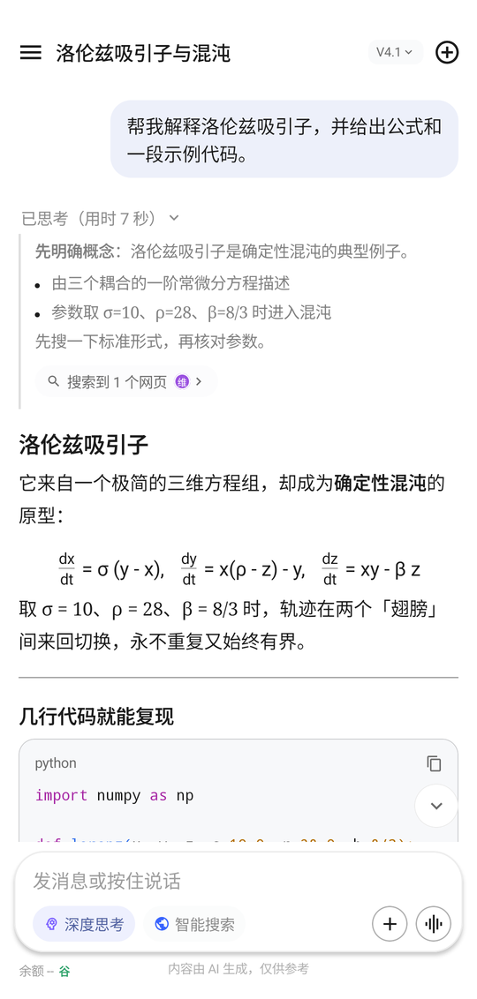
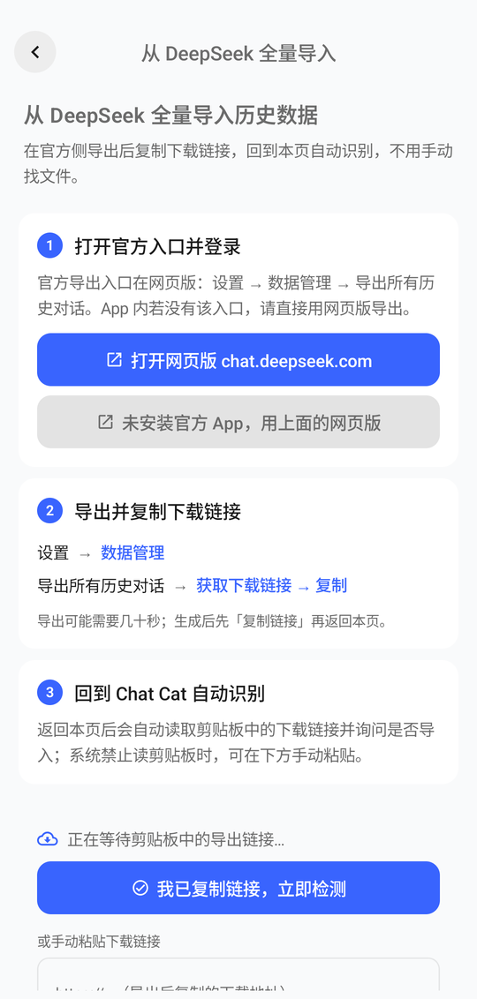

# Chat Cat 🦁

**把你自己的 DeepSeek API Key，变成一只好用的手机 App。**

打开就能聊，界面手感对齐官方 App；对话记录留在你手机里，不经过任何第三方服务器。

> 第三方客户端，通过 DeepSeek 开放平台调用模型服务，**与 DeepSeek 官方没有任何隶属关系**。



---

## 它能帮你做什么

**① 把历史聊天搬过来，一条不丢**

官方 App「设置 → 数据管理 → 导出所有历史对话」，拿到 ZIP 或下载链接后丢进 Chat Cat，
几百个对话连同标题、时间、思考过程一起回来，官方云端保存的附件也会落到本地并正常预览。
可以选择「合并」——只补手机上没有的，重复导入也不会多出一份。
几百 MB 的大包也扛得住，导入时会显示「正在导入 1234 / 2000」，不用盯着屏幕猜进度。



**② 聊起来和官方一个手感**

- 回答太长？思考过程会先收起来，只留一行「已思考（用时 8 秒）」，想看细节点一下展开；你手动展开的，它不会再自己收回去
- 联网搜索不再是一堆生硬步骤：一轮搜索收成两个胶囊——「搜索到 12 个网页」和「已浏览 3 个页面」，后面叠着来源站点的小圆标；点开是干净的结果列表，点条目才进内置浏览器，全程不跳出 App
- 正文里的 1、2、3 是小方块角标，跟在结论后面，点一下就打开对应网页
- 公式是真排版：分式、根号、上下标、求和积分都能正常显示；代码块有六种颜色区分
- 表格与代码块顶部固定一行工具栏：复制、下载、放大查看；宽表格横向滚动，表头不会跟着跑
- 长按文字才出现菜单（复制 / 选择文本 / 重新生成 / 赞踩），平时滑动不会误触

**③ 手上不止一个 Key 也不乱**

公司 Key、个人 Key 分开保存并命名，点一下就切换，不用反复粘贴。

**④ 花在哪一眼看得见**

左下角常显余额；可以设一条预警线，低于它余额变红、小狮子换成「没余粮」的表情；
点小狮子或「给橘狮充饭卡」直接去充值。每条回答都能看这次花了多少 token。

余额页还会提示现在是**峰时段还是谷时段**（谷时价格是峰时的一半），并倒数距离切换还有多久；
聊天页余额后面跟一个单字标记——红色「峰」、绿色「谷」。节假日安排从网上自动更新，不用手动维护。

**⑤ 知道自己用的是正版**

应用会校验自己的安装包签名。发现被人二次打包过，会暂停导入、充值、填 Key 这类操作并提示去官方仓库下载。

## 和官方 App 的关系

| | 官方 App | Chat Cat |
| --- | --- | --- |
| 对话能力 | 官方账号额度 | 你自己的 API Key，用多少付多少 |
| 界面与交互 | — | 对齐官方：思考链折叠、搜索胶囊、来源页、长按菜单、深浅色 |
| 历史记录 | 存在官方账号 | 只存在你手机里，可整包导入导出 |
| 多 Key | 不支持 | 支持，命名后一键切换 |
| 额外能力 | — | 余额预警与充值入口、导入官方导出包、安装包验签 |
| 源码 | 未开源 | GPL-3.0，可自建、可改 |

## 三步开始用

1. 安装 `chatcat-v<版本>-release.apk`（Android 8.0 以上）
2. 去 [DeepSeek 开放平台](https://platform.deepseek.com/api_keys) 创建一个 API Key
3. 打开 Chat Cat → 点小狮子 → 粘贴 Key → 同意协议 → 开聊

> 首次填 Key 前会请你读一遍用户协议与两份官方协议，一次确认，之后不再打扰。

## 功能一览

- 流式对话、思考链（限高展开 / 默认收起 / 默认展开三种模式）、联网搜索
- Markdown：标题、列表、引用、表格（复制 / 下载 CSV、放大查看）、代码块高亮、公式、分隔线
- 引用角标按本轮顺序编号，跟在你关心的结论后面，点一下看来源
- 文件与图片输入（官方 Files API），本地压缩后上传；用户消息前一行横向浏览
- 多版本回答切换、继续生成、重新生成
- 峰谷时段提示：余额页显示当前时段与切换倒计时，聊天页余额后带「峰」/「谷」标记
- 历史会话置顶、重命名、批量删除、整包导入导出（几百 MB 大包带进度，官方导出包里的云端附件一并落地）
- 侧边栏头像可自定义
- 浅色 / 深色 / 跟随系统
- 应用内浏览器，正文链接与搜索结果都不跳出应用

## 隐私

- 不收集数据，不接统计与广告 SDK
- 对话、设置、Key 只存在本机；卸载即删除
- Key 加密保存，界面只显示首尾 4 位
- 联网只发生在两件事：调用 DeepSeek API、你主动打开网页

## 自己构建

需要 JDK 17 与 Android SDK 36。

```bash
cp local.properties.example local.properties   # 填 sdk.dir
./gradlew :app:assembleDebug                   # 直接可装的 debug 包
```

打正式包需要自己的签名：

```bash
cp keystore.properties.example keystore.properties   # 填 keystore 路径与密码
./gradlew :app:assembleRelease
```

> 自行发布前，请把新证书的 SHA-256 填到
> `app/src/main/java/com/chatcat/security/SignatureGuard.kt` 的 `OFFICIAL_SHA256`，
> 否则应用会把自己判定为「签名异常」。

技术栈：Kotlin · Jetpack Compose（Material 3）· Room · DataStore · OkHttp，无第三方 UI 框架、无统计 SDK。

更多说明见 [docs/](docs/)。

## 致谢

界面与协议实现参考了 DeepSeek 官方开源项目 [chat-demo](https://github.com/deepseek-ai/chat-demo)（MIT），
许可全文见 [third_party/chat-demo-LICENSE.txt](third_party/chat-demo-LICENSE.txt)。感谢官方的无私奉献。

接口细节参考 [DeepSeek API 文档](https://api-docs.deepseek.com/zh-cn/)。

## 许可

GNU General Public License v3.0，见 [LICENSE](LICENSE)。可自由使用、修改与再分发；
分发衍生作品时须以同一协议开源并提供对应源码。

## 免责声明

本项目为第三方客户端，与 DeepSeek 官方无隶属关系，也未获官方背书。
模型生成内容由 AI 产生，可能存在错误，请自行核实；请勿利用本应用生成、传播违反法律法规的内容。
因使用本应用产生的任何后果由使用者自行承担。
