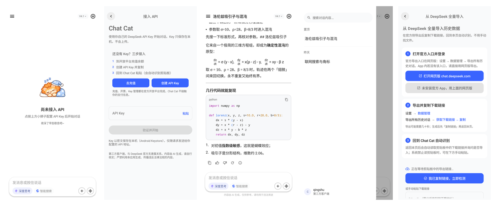

# Chat Cat

**一个安卓上的 DeepSeek 客户端。**
界面、文案、手感都对着官方 App 还原，只是模型调用走你自己的 API Key。

`Android 8.0+` · `GPL-3.0` · `v1.5.2` · 非官方产品

[开始使用](#开始使用) · [常见问题](#常见问题) · [许可与声明](#许可与声明)

---

## 它是什么

官方 App 的免费额度用完之后，常规做法是去开放平台买 API。但把 API 直接接一个客户端，体验通常是断崖式的：界面是模板，思考过程看不见，搜索来源点不开，几百个历史对话只能从零重来。

Chat Cat 只做一件事：**额度是你自己的，体验还是官方的。**

- 对话、思考链、搜索来源、回答版本、引用角标，都按官方 App 的交互来做，不是「能聊就行」的壳
- 提示语、状态文案、空页面语气，也按官方的那一套来写
- 再补上官方 App 不会替你做的三件事：**接入别绕路、历史能搬家、花了多少钱看得见**

它不替代官方 App，它替代的是「额度用完了，要么忍、要么换一个难用的客户端」这个处境。

## 截图



*从左到右：待机页（橘狮）、三步接入、对话与公式代码、会话分组、从官方导入。原尺寸见 [screenshots/](screenshots/)。*

## 手感：照着官方 App 做，不是照着 API 文档做

大多数人换客户端，第一分钟就放弃了——因为「不像」。Chat Cat 的对齐单位是**操作**，不是功能清单。

**对话里**

- 流式输出是逐字出来的，随时能停；停下或截断后，原地出现「继续生成」，接着同一段回答往下写
- 思考过程是官方那种「左侧细线 + 灰字逐行出现」，不是一段静态灰块；结束后收成一行「已思考（用时 N 秒）」，想回看再展开
- 联网时，搜索和打开网页的每一步都看得见；连续的搜索会合并成「搜索到 N 个网页」一颗胶囊，不再一行行刷屏
- 来源编号 1、2、3 顺着结论排，点角标直接打开那一页；回答末尾还有「N 个网页」的汇总，点开是页中页
- 重新生成不覆盖旧答案。回答下方 `‹ 2/3 ›` 可以来回切，改提问也保留原来那一支
- 正文默认选不中——没有误触的涟漪，也不会手一滑选中半屏字。长按才出菜单：复制、选择文本、修改、分享
- 公式是真排版（分式、根号、上下标、积分），代码块多色高亮，表格能横滚、能一键复制成 CSV

**对话外**

- 侧边栏按「置顶 / 今天 / 昨天 / 7 天内 / 30 天内」分组，跟官方一样不需要自己整理
- 每次打开都停在新建对话上，不会莫名其妙打开上周那个聊天；想找旧的从侧边栏进
- 长按会话就有重命名、置顶、多选、删除，多选能批量置顶和删除
- 模型切换带成本提醒，每个会话各自记住用哪个

这些细节单看都不起眼，合起来才是「不用重新学一遍」的那种感觉。

## 文案：连提示语都照着官方写

界面像不像，一半在排版，一半在措辞。Chat Cat 的文案不是自己另写一套，而是**照官方的语气来**：

- 该叫「深度思考」就叫深度思考，该叫「智能搜索」就叫智能搜索，不自创名词
- 思考完的收尾是「已思考（用时 8 秒）」，联网的收尾是「搜索到 12 个网页」——和官方一模一样的句式
- 被风控拦下时，不弹红色的「生成失败」，而是把已经生成的内容撤回，留一句 *「这个话题我不太方便展开，我们聊点别的吧」*
- 空页面会看时间说话，深夜是「夜深了早些歇息吧~」
- 不用感叹号堆热情，不写「强大的」「全新的」这类话

一个第三方客户端最容易露馅的地方就是文案。这一层对上了，「像官方」才成立。

## 接入：三步，不用翻文档

买 API 最烦的不是付钱，是找入口：开放平台的控制台、充值页、密钥页各在一个地方，文档还得自己读。Chat Cat 把这条路缩成一张卡片：

```
① 去充值   →   ② 创建 API Key   →   ③ 回到 Chat Cat，粘贴
```

- 「去充值」「创建 API Key」两个按钮**直接打开开放平台对应的网页**，不用自己找
- 在浏览器里复制完 Key 切回来，应用会自己认出剪贴板里的 `sk-` 开头的 Key，弹窗问你要不要填入，只显示首尾几位
- 读不到剪贴板也不拦路：输入框右侧有「粘贴」，或者直接手输
- 可以存多个 Key 并命名（工作号 / 个人号），列表里标出「使用中」，一点就切
- Key 用 Android Keystore 加密存在本机，只随请求发给你配置的那个 API 地址

## 搬家：把官方 App 的历史对话整包带过来

换客户端最大的沉没成本是历史记录。Chat Cat 的做法是：**你去官方导出，剩下的它接手。**

```
Chat Cat：从 DeepSeek 全量导入历史数据
   ↓ 打开官方入口（网页版 / 已装的官方 App）
官方：设置 → 数据管理 → 导出所有历史对话 → 获取下载链接 → 复制
   ↓ 切回 Chat Cat
自动读剪贴板 → 认出这是导出文件 → 问你是否下载导入
   ↓ 确认
下载 → 校验 → 预览会话数 / 消息数 → 导入 → 「已导入 N 个对话、M 条消息」
```

三个不折腾的地方：

- **不认死链接格式**：官方换了下载域名也认得出；同时会挡掉冒充官方的域名，确认框只显示主机和文件名，不让你在一串长链接里判断真假
- **失败有退路**：读不到剪贴板、链接过期、下载中断，都可以改成手动粘贴链接，或者直接从文件管理器选那个 `deepseek_data-*.zip`
- **重复导入不会长出副本**：默认「合并增量」，按标题 + 创建时间对一遍，只补新的；想彻底重来再选「覆盖」
- 下载的压缩包只落在缓存里，导入一结束（成功或失败）立刻删掉

## 花钱：余额常显，心里有数

用 API 而不是订阅，最大的心理负担是「不知道还剩多少」。所以余额不是一个藏在设置里的数字：

- **对话页左下角一直显示余额**，每轮回答结束自动刷新，平时每 5 分钟同步一次，不打断对话
- 点一下进余额页：总余额、充值余额、赠金余额分开列，一眼知道哪部分是送的
- 可以自己设**余额预警线**（¥1–200）。低于这条线，对话页的余额变提示色，余额页的小狮子从「吃鱼」变成「没余粮」，点它就能直接去充值
- 每条回答底部能看这一次用了多少 token；设置里有本月累计和 ¥ 估算，区分模型、缓存命中、峰谷价
- 余额不足时，错误提示不是一句冷冰冰的报错，而是告诉你「余额不足」并给一个去充值的入口

## 它有名字，叫橘狮

橘狮是这个客户端的 IP，不是贴纸。它只在需要你注意的时候出现：

- 打开应用时在空对话页待机，每次随机一个状态：打瞌睡、戴睡帽、发呆
- 余额充足时叼着鱼，见底时一脸「没余粮」，下面常驻一句「给橘狮充饭卡」，点了直达充值页
- 安装包签名校验页有 18 张「一切正常」和 9 张「有点不对劲」的插画，随机出一张，把一件很技术的事说得不那么技术
- 全部是手绘质感的暖橙色，跟官方那种冷静的蓝灰界面放在一起，是刻意的反差：**工具可以严肃，用起来不必**

## 隐私：没有服务器，也没有账号

这一条没什么可包装的，就是很干脆：

- **不运营任何后端**。没有登录、没有同步、没有埋点，作者看不到你的任何一条对话
- 对话、附件、设置全部存在本机；删掉应用，数据就没了
- API Key 用 Android Keystore 加密保存，界面上只显示 `sk-ab…7890` 这样的掩码，不提供明文查看，也不提供导出
- 日志里只有错误类型和 `request_id`，不含对话正文，也不含 Key
- 剪贴板只在「接入 API」和「导入历史」这两个页面处于前台时读，读到目标内容才弹窗；不在后台轮询
- 请求默认带 `safety_check: high`，走官方的内容安全审核
- 整个应用只有一个对外出口：你自己填的那个 API 地址

## 和官方 App 的差别

诚实列一下，免得装完才发现：

| 能力 | 情况 |
| --- | --- |
| 语音 | **没有**。语音通话、语音输入暂未实现，输入框的按住说话是沿用官方的占位文案 |
| 工具箱 | 没有官方的那些小工具入口，能力集中在对话本身 |
| 多语言 | 只有简体中文 |
| 搜索 | 会话搜索覆盖标题和预览，还没做全文检索 |
| 附件 | 导入的历史只带文件名、大小、类型，官方云端的附件二进制不在导出包里，导不过来 |
| 数据 | 与官方 App、与 Chat Cat Beta 三者数据互不相通，换版本前先导出备份 |

## 开始使用

1. 到 [Releases](../../releases) 下载最新的 `chatcat-vX.Y.Z-release.apk`（正式版）或 `chatcat-beta-...apk`（尝鲜版）
2. 安装后直接进入对话页，没有 Key 时点小狮子，按「三步接入」走一遍
3. 想搬历史，就去「设置 → 数据管理 → 从 DeepSeek 全量导入历史数据」

> 正式版和 Beta 用不同包名（`com.chatcat` / `com.chatcat.beta`），可以同时装、互不覆盖，数据也互相独立。

**费用**：应用本身免费开源。模型按量计费，账单在 DeepSeek 开放平台，跟本项目无关。

## 常见问题

**Q：不填 Key 能用吗？**
不能。所有对话都直接请求开放平台，没有内置 Key，也没有共享 Key 池。

**Q：会和官方 App 抢登录、被封号吗？**
不会。走的是开放平台公开的 API，不碰官方 App 的私有接口，也不复用它的代码和资源。

**Q：导入会不会把对话搞成两份？**
默认合并增量，按「标题 + 创建时间」去重，同一份备份导两次不会多出副本。真想要干净重来，选「覆盖」——它会先清空，不可撤销，建议先导出一次备份。

**Q：为什么没有语音？**
语音是一整组功能（录音、识别、合成），做不完整不如不做，暂时不排期。

**Q：换手机怎么办？**
在新机填同一个 Key（或重新建一个），再把旧机导出的 ZIP 导进来。Key 不跟着备份走。

## 从源码构建

需要 JDK 17 和 Android SDK（compileSdk 36 / build-tools 36.0.0）。

```bash
./gradlew :app:assembleDebug        # 产物：app/build/outputs/apk/debug/app-debug.apk
./gradlew :app:testDebugUnitTest    # 单测：SSE 解析、上下文拼装、角标重排
```

国内网络已默认走阿里云 Maven 与腾讯 Gradle 镜像。打包正式版需要自己的 keystore，参考 `keystore.properties.example`。

设计与实现文档在 [docs/](docs/)，变更记录在 [CHANGELOG.md](CHANGELOG.md)。

## 许可与声明

- 本项目以 **GNU General Public License v3.0** 发布，全文见 [LICENSE](LICENSE)。可自由使用、修改、分发；分发衍生作品须以同一协议开源并提供源码。
- 对话交互与协议实现参考了官方开源前端 [chat-demo](https://github.com/deepseek-ai/chat-demo)（MIT），其许可全文保留在 [third_party/chat-demo-LICENSE.txt](third_party/chat-demo-LICENSE.txt)，应用内「开源许可」页也置顶展示。
- 「DeepSeek」为杭州深度求索人工智能基础技术研究有限公司的商标。本项目是第三方客户端，与其无隶属关系，界面内已注明。
- 作者：qingshu
