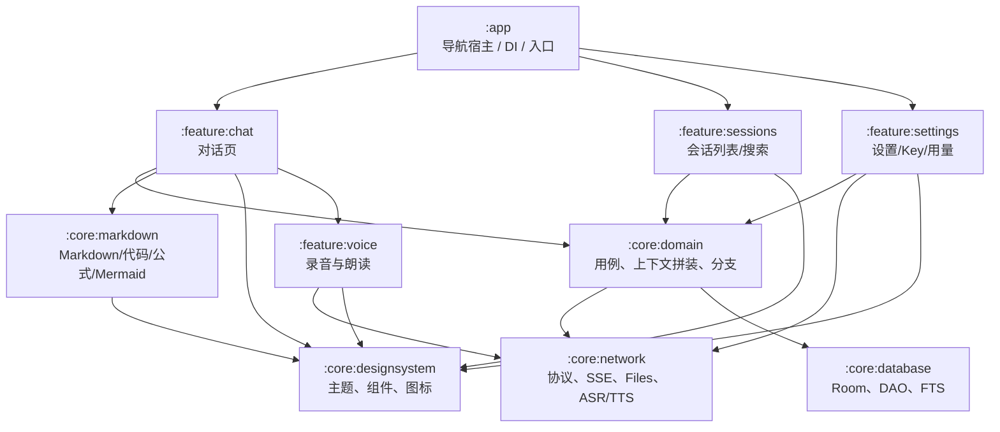
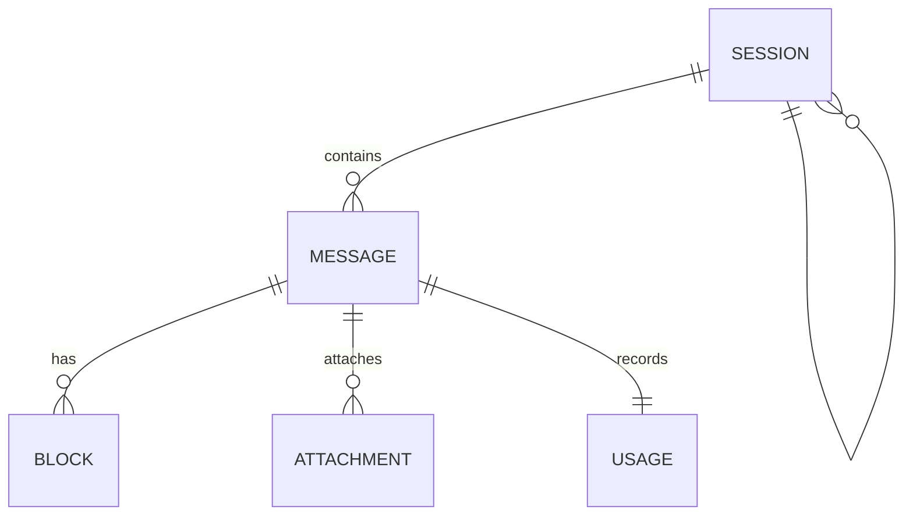
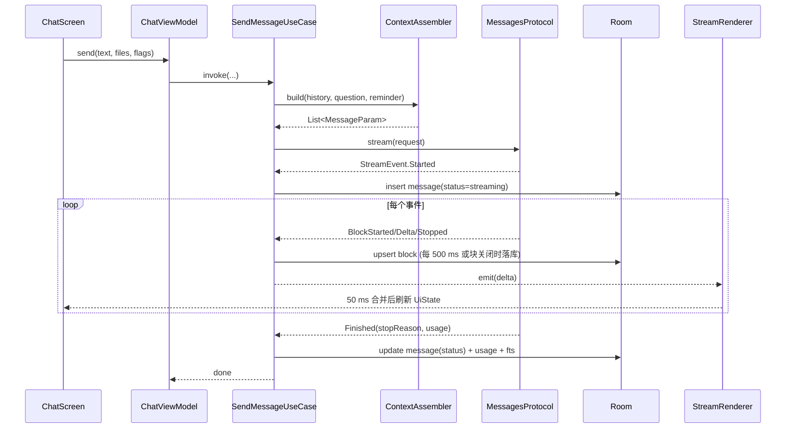
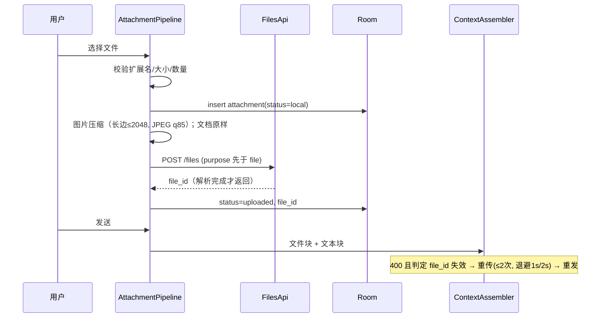

# 04 技术架构设计

- 版本：v1.0
- 目标平台：Android `minSdk 26`（Android 8.0）、`targetSdk 36`、仅 `arm64-v8a`
- 语言/UI：Kotlin 2.x + Jetpack Compose
- 架构：单 Activity + Compose Navigation，MVVM + 单向数据流，分层 `ui / domain / data / core`

> 为什么 minSdk 26 而不是官方的 24：Compose 与 `EncryptedSharedPreferences`、`AudioTrack.Builder`、`java.time` 在 26 以下需大量兼容代码；本项目是个人工具，覆盖 26+ 已足够（Android 8.0 以上占比 >98%）。若后续要下沉，只需替换这三处。

---

## 1. 技术选型

| 层 | 选择 | 理由 | 被否方案 |
| --- | --- | --- | --- |
| UI | Jetpack Compose + Material 3 | 官方 App 即 Compose（86 处引用），流式局部刷新友好 | View/XML（流式重排成本高）、Flutter（与官方手感有差、包体大）、RN（性能与生态劣势） |
| 导航 | Navigation-Compose，类型安全路由 | 单 Activity，会话/设置/预览页切换 | Fragment 导航 |
| 状态 | ViewModel + `StateFlow<UiState>` + 单向事件 | 流式高频更新可控，易测 | mutable 全局单例 |
| 本地存储 | Room（SQLite）+ FTS4 | 结构化消息块、分支查询、全文搜索 | 纯 JSON 文件（查询弱）、Realm（已停维护）、WCDB（官方用，但我们无需其能力） |
| 键值/设置 | DataStore(Preferences) | 异步、类型安全 | SharedPreferences |
| 网络 | OkHttp 4 + kotlinx.serialization | SSE 手写解析最可控；序列化与 Kotlin 数据类型对齐 | Retrofit（SSE 支持弱）、Ktor（团队熟悉度） |
| 序列化 | kotlinx.serialization（JSON） | 与官方一致；多态内容块用 sealed + 自定义 serializer | Moshi/Gson |
| 图片 | Coil 3 | Compose 原生、内存控制好 | Glide |
| 公式 | `jlatexmath-android` | 官方用 JLatexMath；原生绘制，滚动不卡 | KaTeX in WebView（滚动卡、需 JS 桥） |
| 代码高亮 | `dev.snipme:highlights`（Kotlin 纯实现） | 离线、Compose 友好、无需 WebView | Prism/highlight.js in WebView |
| Markdown | `commonmark-java` 解析 + 自写 Compose 渲染器 | 标准 AST、可增量；官方自研 `_DSFMLexer` 但无源码 | Markwon（View 体系）、multiplatform-markdown（扩展性差） |
| 图表 | WebView + 离线 `mermaid.min.js` | 官方同样用 WebView；纯原生不现实 | 自研渲染器（成本极高） |
| 语音录制 | `AudioRecord` → 16 kHz/16-bit 单声道 WAV | 体积小、ASR 直收；避免 MediaRecorder 的容器差异 | MediaRecorder（AMR/AAC 需转码） |
| 音频播放 | `AudioTrack`（PCM 24 kHz 直出） | TTS 返回裸 PCM，零解码延迟 | ExoPlayer（对裸 PCM 反而不便） |
| DI | 手写 `AppContainer` + 构造注入 | 项目规模不需要 Hilt/Koin，减少编译期成本 | Hilt（KSP 编译慢） |
| 测试 | JUnit5 + Turbine + MockWebServer + Compose UI Test | 协议层与拼装逻辑必须可单测 | 仅手工测试 |

版本节奏：依赖版本用 `gradle/libs.versions.toml` 统一管理，禁止各模块散落版本号。

---

## 2. 模块与依赖



依赖规则（用 Gradle 模块强制）：

- `feature` 之间**不互相依赖**，共享逻辑下沉到 `core:domain`。
- `core:network` 不知道 Room，`core:database` 不知道 OkHttp；粘合在 `core:domain`。
- UI 层不出现 `MessageDto`，只出现 `UiMessage`（映射在 domain）。

---

## 3. 目录结构

```
app/src/main/java/com/chatcat/
├─ ChatDemoApp.kt                 # Application + AppContainer
├─ MainActivity.kt                # 单 Activity，setContent
├─ navigation/                    # 路由定义、NavHost
├─ di/AppContainer.kt
core/
├─ network/
│  ├─ Http.kt                     # OkHttpClient、超时、拦截器（脱敏日志）
│  ├─ sse/SseReader.kt            # 字节流 → (event, data) 序列
│  ├─ protocol/ChatProtocol.kt     # 协议接口
│  ├─ protocol/MessagesProtocol.kt # Anthropic 兼容实现
│  ├─ protocol/OpenAiProtocol.kt   # Chat Completions 备实现
│  ├─ protocol/dto/               # 请求/响应/事件 DTO
│  ├─ files/FilesApi.kt
│  ├─ speech/SpeechApi.kt
│  └─ ApiError.kt                 # 错误分类与文案映射
├─ database/
│  ├─ AppDatabase.kt
│  ├─ entity/*.kt
│  ├─ dao/*.kt
│  └─ converter/*.kt
├─ domain/
│  ├─ model/                      # UiMessage/UiBlock/UiSession 等不可变模型
│  ├─ context/ContextAssembler.kt # 上下文拼装（02 §13）
│  ├─ chat/SendMessageUseCase.kt
│  ├─ chat/RegenerateUseCase.kt
│  ├─ chat/ContinueUseCase.kt
│  ├─ chat/TitleUseCase.kt
│  ├─ files/AttachmentPipeline.kt
│  └─ usage/UsageCalculator.kt
├─ designsystem/
└─ markdown/
feature/
├─ chat/
│  ├─ ChatScreen.kt
│  ├─ ChatViewModel.kt
│  ├─ components/ (MessageList, UserBubble, AssistantBubble, ThinkingBlock,
│  │               SearchCard, CitationChip, Composer, AttachmentStrip, ReplyActions)
│  └─ stream/StreamRenderer.kt    # 节流与增量渲染
├─ sessions/
├─ settings/
└─ voice/
```

---

## 4. 数据模型

### 4.1 ER 概览



分支用「父指针 + 活动叶子」表达：每条消息记录 `parent_id`，会话记录 `active_leaf_id`；当前展示路径 = 从叶子沿 `parent_id` 回溯。这样「编辑/重生成/切分支」都只改一个指针，不搬数据。

### 4.2 表结构

```sql
CREATE TABLE sessions (
  id                TEXT PRIMARY KEY,          -- UUID
  title             TEXT NOT NULL DEFAULT '',
  title_locked      INTEGER NOT NULL DEFAULT 0,-- 手动重命名后置 1，阻止自动标题覆盖
  model             TEXT NOT NULL,             -- deepseek-flash / deepseek-v4-pro（可按会话切）
  created_at        INTEGER NOT NULL,
  updated_at        INTEGER NOT NULL,
  pinned            INTEGER NOT NULL DEFAULT 0,
  pinned_at         INTEGER,
  active_leaf_id    TEXT,                      -- 当前分支末端消息
  last_preview      TEXT NOT NULL DEFAULT ''   -- 列表页摘要，避免列表页 join
);
CREATE INDEX idx_sessions_updated ON sessions(pinned DESC, updated_at DESC);

CREATE TABLE messages (
  id            TEXT PRIMARY KEY,
  session_id    TEXT NOT NULL REFERENCES sessions(id) ON DELETE CASCADE,
  parent_id     TEXT REFERENCES messages(id) ON DELETE SET NULL,
  role          TEXT NOT NULL,                 -- user / assistant
  status        TEXT NOT NULL,                 -- pending / streaming / done / aborted / failed / refused
  stop_reason   TEXT,                          -- end_turn / max_tokens / refusal / aborted / error
  error_kind    TEXT,                          -- 见 ApiError.kind
  error_detail  TEXT,
  model         TEXT,
  provider_msg_id TEXT,                        -- message_start.message.id
  reminder      TEXT,                          -- 本轮快照的 latest_reminder
  used_tools    INTEGER NOT NULL DEFAULT 0,    -- 1 表示实际产生过联网工具块（禁续写）
  continued_count INTEGER NOT NULL DEFAULT 0,  -- 续写次数（仅统计，不做硬上限）
  active        INTEGER NOT NULL DEFAULT 1,    -- 版本化回答：同一 parent_id 下只有 1 条参与上下文
  thinking_ms   INTEGER NOT NULL DEFAULT 0,    -- 思考耗时，用于「已思考（用时 N 秒）」
  created_at    INTEGER NOT NULL,
  finished_at   INTEGER,
  seq           INTEGER NOT NULL               -- 同会话内自增，稳定排序
);
CREATE INDEX idx_messages_session ON messages(session_id, seq);
CREATE INDEX idx_messages_parent ON messages(parent_id);

-- Android 实现（Room v1 → v2 迁移）：
--   ALTER TABLE messages ADD COLUMN active INTEGER NOT NULL DEFAULT 1;
--   ALTER TABLE messages ADD COLUMN thinking_ms INTEGER NOT NULL DEFAULT 0;
-- 「重新生成」= 新建一条 parent_id 指向提问的回答，并把同组其他回答 active 置 0；
-- 切版只改 active，不删除、不重建消息（旧版本原样保留，可切回）。

CREATE TABLE blocks (
  id          TEXT PRIMARY KEY,
  message_id  TEXT NOT NULL REFERENCES messages(id) ON DELETE CASCADE,
  ordinal     INTEGER NOT NULL,                -- 与 SSE index 对应
  type        TEXT NOT NULL,                   -- text / thinking / server_tool_use /
                                               -- web_search_tool_result / web_fetch_tool_result
  text        TEXT,                            -- 文本类块的增量正文（便于 FTS）
  payload     TEXT,                            -- JSON：工具块、引用、签名等
  closed      INTEGER NOT NULL DEFAULT 0
);
CREATE INDEX idx_blocks_message ON blocks(message_id, ordinal);

CREATE TABLE attachments (
  id          TEXT PRIMARY KEY,
  session_id  TEXT NOT NULL,
  message_id  TEXT,                            -- 未发送时为 NULL（草稿）
  filename    TEXT NOT NULL,
  mime        TEXT NOT NULL,
  size_bytes  INTEGER NOT NULL,
  local_path  TEXT,                            -- 私有目录副本（图片缩略图用）
  purpose     TEXT,                            -- null / text_recognition / rich_layout_recognition / user_data
  file_id     TEXT,                            -- 上传成功后的服务端 id
  status      TEXT NOT NULL,                   -- local / uploading / uploaded / failed / expired
  error       TEXT,
  width       INTEGER, height INTEGER, pages INTEGER,
  created_at  INTEGER NOT NULL
);
CREATE INDEX idx_attachments_message ON attachments(message_id);
CREATE INDEX idx_attachments_session ON attachments(session_id);

CREATE TABLE usage (
  message_id      TEXT NOT NULL REFERENCES messages(id) ON DELETE CASCADE,
  request_seq     INTEGER NOT NULL DEFAULT 0,  -- 0=首次请求，1..=第 n 次续写
  session_id      TEXT NOT NULL,
  model           TEXT NOT NULL,
  input_tokens    INTEGER NOT NULL DEFAULT 0,
  cache_read      INTEGER NOT NULL DEFAULT 0,
  output_tokens   INTEGER NOT NULL DEFAULT 0,
  thinking_tokens INTEGER NOT NULL DEFAULT 0,
  safety_tokens   INTEGER NOT NULL DEFAULT 0,
  searches        INTEGER NOT NULL DEFAULT 0,  -- tool_search（计费）
  fetches         INTEGER NOT NULL DEFAULT 0,  -- tool_fetch
  image_searches  INTEGER NOT NULL DEFAULT 0,
  cost_estimate   REAL NOT NULL DEFAULT 0,     -- 元，按价目表估算
  created_at      INTEGER NOT NULL,
  PRIMARY KEY (message_id, request_seq)
);

-- 续写是同一 message 的第 n 次请求：每次请求独立一行，展示时 SUM 聚合。
-- chat-demo 直接覆盖 usage（它全站不展示用量，覆盖无感）；我们要做用量页，覆盖会少算，
-- 故按「一行一请求」落库，属有意差异，见 02 §13.1。

-- 全文搜索：只索引可见正文
CREATE VIRTUAL TABLE messages_fts USING fts4(content, message_id UNINDEXED, tokenize=unicode61);
```

### 4.3 关键约束

- 消息写入必须与 FTS 同步：`blocks.text` 变化时更新 `messages_fts`（用触发器或仓储层统一处理，二选一，不许混用）。
- `messages.status=streaming` 的记录在 App 冷启动时统一改为 `aborted`（说明上次进程被杀），并允许「重试」。
- 删除会话用 `ON DELETE CASCADE`，同时清 `attachments.local_path` 指向的文件（数据库无法级联删文件，仓储层负责）。
- 单条消息的块数量上限不设，但 `payload` 单条 >256 KB 时要压缩（搜索结果多时会发生）。

### 4.4 归档格式（导出 / 导入，对齐官方网页端 v3）

导出为 ZIP（`deepseek_data-YYYY-MM-DD.zip`），由系统文件选择器（SAF）读写，无需存储权限：

```
manifest.json                    {"export_format_version":3}
user.json                        可选；官方含账号信息，本项目不写
chat_sessions/{session_id}.json  会话消息树
chat_session_index.json          会话索引
chat_sessions/{id}_files/...     图片（本版本跳过）
```

会话文件的消息字段：`id`（数值）、`parent_id`、`role`（USER/ASSISTANT）、`status`
（FINISHED/INCOMPLETE/TIMEOUT/CONTENT_FILTER/WIP…）、`thinking_enabled`、`search_enabled`、
`inserted_at`（ISO8601）、`fragments[]`（REQUEST/RESPONSE/TEMPLATE_RESPONSE/THINK/TOOL_SEARCH/
TOOL_OPEN/READ_LINK/FILE…）。

实现要点：

- **导出**：只导出当前可见分支；「重新生成」的多版本作为兄弟节点，`current_message_id` 指向当前版本；
  工具块无结构化数据、不导出但保留 `search_enabled`。manifest 只写 `export_format_version`。
- **导入**：支持整包套一层目录（`deepseek_data-xxx/...`）；沿 `current_message_id` 回溯到根，只导入当前分支；
  先完整解析并校验索引，成功后单事务**替换**全部历史（对齐官方），失败不动原数据。
- **用户信息**：只读 `user.json`（含 `oauth_profiles[].profile_json` 字符串 JSON）中的显示名；
  邮箱、手机号等字段一律不解析。是否保留由用户在导入确认页显式选择。
- 兼容 v0.2.6 的 `chatdemo.archive`（manifest 含 `format`）导入；图片/附件暂不支持。

---

## 5. 协议层设计

### 5.1 抽象

```kotlin
interface ChatProtocol {
    fun stream(req: ChatRequest, cancel: CancellationToken): Flow<StreamEvent>
    suspend fun complete(req: ChatRequest): ChatResponse
}

sealed interface StreamEvent {
    data class Started(val providerMessageId: String, val model: String) : StreamEvent
    data class BlockStarted(val index: Int, val block: BlockStart) : StreamEvent
    data class BlockDelta(val index: Int, val delta: BlockDelta) : StreamEvent   // text/thinking/signature/citation
    data class BlockStopped(val index: Int) : StreamEvent
    data class TitleReceived(val title: String) : StreamEvent
    data class Finished(val stopReason: String, val usage: Usage?) : StreamEvent
}
```

`MessagesProtocol` 与 `OpenAiProtocol` 各自把 SSE 转成同一套 `StreamEvent`，上层无感。切换由 `ProviderFactory` 依据设置（默认 Messages；Base URL 为 OpenAI 兼容中转时用 OpenAi）。

### 5.2 SSE 读取

要点（照抄 chat-demo 的语义，不抄实现）：

- 按 `\n\n` 分帧，容忍 `\r\n`；`event:` 与 `data:` 可多行，`data:` 行以 `\n` 连接。
- 忽略注释行（以 `:` 开头，用于 keep-alive）与 `ping` 事件。
- 无名 `data` 帧若含 `error.message` → 抛 `ApiError(kind=stream)`。
- 收到 `message_stop` 才算正常结束；循环结束仍未见到 → `ApiError(kind=interrupted)`。
- 取消：`Call.cancel()`；读循环抛 `IOException` 时若已取消，转成 `CancellationException` 不当作错误上报。

```kotlin
class SseReader(private val source: BufferedSource) {
    fun frames(): Sequence<SseFrame> = sequence {
        while (true) {
            val event = StringBuilder(); val data = StringBuilder()
            while (true) {
                val line = source.readUtf8Line() ?: run {
                    if (data.isNotEmpty()) yield(SseFrame(event.toString(), data.toString()))
                    return@sequence
                }
                if (line.isEmpty()) break
                if (line.startsWith(":")) continue
                when {
                    line.startsWith("event:") -> event.append(line.removePrefix("event:").trim())
                    line.startsWith("data:")  -> {
                        if (data.isNotEmpty()) data.append('\n')
                        data.append(line.removePrefix("data:").trimStart())
                    }
                }
            }
            if (data.isNotEmpty() || event.isNotEmpty()) yield(SseFrame(event.toString(), data.toString()))
        }
    }
}
```

### 5.3 错误映射

```kotlin
sealed class ApiError(val kind: Kind, cause: Throwable?) : Exception(cause) {
    enum class Kind { AUTH, BALANCE, CONTENT_RISK, CONTEXT_LIMIT, RATE_LIMIT,
                      SERVER_BUSY, UPLOAD_TOO_LARGE, PARSE_FAILED, NETWORK,
                      STREAM_INTERRUPTED, PROTOCOL, CANCELLED, UNKNOWN }
}
```

映射规则集中在 `ApiErrorMapper`：HTTP 状态码 + 响应体 `error.message` 关键字 + 流内状态，一起判。UI 只认 `Kind`，不解析英文原文。

---

## 6. 流式渲染管线



关键约束：

1. **两路节流**：网络帧 → 内存累积（不落库）；UI 刷新 50 ms 合并一次；落库 500 ms 或块结束一次。避免每 token 一次 IO 与一次重组。
2. **块级缓存**：已关闭的块渲染结果缓存（Compose `key(block.id)`），只重绘最后一个未关闭块。
3. **不重排**：流式期间禁止「自动重算排版」类操作（如表单化 Markdown 的整段重解析）。做法是「按块解析」：每个 text 块独立解析为 AST，块内追加时只重解析该块，且以「稳定前缀」为界（遇到未闭合的代码块/公式/表格，暂按纯文本渲染，闭合后升级为富文本）。
4. **滚动**：默认跟随底部；用户上滑超过 64 dp 停止跟随并显示浮标；发送后重置。
5. **状态落库时机**：`message_stop` 后一次性写 `status/stop_reason/usage/title`，保证崩溃时数据一致（宁可丢最后一帧，不写半状态）。续写按 chat-demo 语义处理：新块**追加**到已有块之后（`blockIndexes` 映射），**不回滚**；正常/停止结束可再次续写，失败则 `status=error` 且不再提供「继续」，只保留「重新生成」。每次续写写入一行 `request_seq` 递增的 usage，展示时按 `message_id` SUM 聚合。

---

## 7. 上下文拼装（ContextAssembler）

严格按 [02 §13](02-API能力地图与协议选型.md) 实现，接口：

```kotlin
class ContextAssembler {
    fun build(
        activePath: List<UiMessage>,   // 从 active_leaf 回溯后正序
        question: UiMessage,
        reminder: String?,
        enableThinking: Boolean,
        continueFrom: UiMessage? = null
    ): List<MessageParam>
}
```

规则要点（实现时逐条写测试）：

- 丢弃「无可用回答」的轮次；拒答轮次保留展示但不进上下文。
- 历史 assistant 去 thinking、去 citations、合并文本、只留 read_link 的工具块（含 signature）。
- read_link 缺 signature → 调用与结果一起丢。
- `latest_reminder` 仅在内容变化时插入。
- 续写：保留本轮思考 + signature；空 prefill 丢弃。
- 输出必须**确定性**：同样的输入必得同样的 JSON（便于快照测试与缓存命中）。

**测试基线**：用 chat-demo 的 `toRequestMessages` 行为做 12 条对照用例（纯文本、思考、搜索、读链接、多附件、续写、拒答、空回答、分支、跨天 reminder、文件失效、超长历史）。

---

## 8. 文件管线



细节：

- **校验**：扩展名白名单（对齐 chat-demo 的 `ACCEPT_FILE_EXTS`，约 400 项，统一放在 `core/domain/files/UploadExts.kt`）；单文件 ≤64 MB（图片）/≤100 MB（文档）；单条消息 ≤50 个附件。
- **purpose 选择**：图片不传；pdf/doc/docx/ppt/pptx → `rich_layout_recognition`；其余 → `user_data`。
- **超时**：OkHttp `callTimeout = 0`（不设总超时），`readTimeout = 300 s`；进度用 `RequestBody` 包装上报字节数。
- **图片本地副本**：压缩后存 `filesDir/attachments/{id}.jpg`，仅用于 UI 预览；发送用原图（若 >32 MB 走 Files）。
- **失败分类**：408 上传超时 / 413 过大 / 500 解析不完整 / 503 繁忙 / 504 解析超时 / 400 格式或加密文档。
- **清理**：会话删除时删本地副本；服务端文件不删（无索引接口，且删除需 file_id；可选延时 `DELETE /files/{id}`）。

---

## 9. 语音管线

**录音**：`AudioRecord`（16 kHz、MONO、16-bit）→ 写 WAV 头 → 上限 120 s 自动停止。时长展示 + 剩余秒数提示。超过 120 s 自动切段（前置 200 ms 重叠防断字）。

**识别**：`POST /v1/tools/asr`（multipart `file`），超时 60 s；返回 `text` 填入输入框（光标置末），**不自动发送**（用户可改）。

**朗读**：按句切分（`。！？；\n` 与 80–120 字上限）→ 顺序请求 `/v1/tools/tts`（`format=pcm`）→ `AudioTrack`（24 kHz/16-bit/MONO）写入播放。下一句预取（最多 2 路并发），当前句播完立即写下一段，做到无缝。停止 = 取消所有 call + `AudioTrack.pause()+flush()+release()`。

**约束**：TTS 单次 ≤10,000 计费字符，长回答必须切分；`filter_markdown=true` 由服务端过滤代码块与表格，客户端不需要预处理（但要跳过纯代码块，避免朗读出代码）。

---

## 10. 安全与隐私

| 项 | 做法 |
| --- | --- |
| API Key 存储 | `EncryptedSharedPreferences`（Keystore 派生 AES256-GCM）；不写 DataStore 明文 |
| Key 使用 | 仅网络拦截器注入；日志拦截器对 `x-api-key` / `Authorization` 做 `***` 替换 |
| 崩溃上报 | 默认关闭；开启时白名单字段，禁止上传消息正文与 Key |
| 数据库 | 不加密（一阶段）；若后续需要，用 SQLCipher 或系统级加密目录 |
| 附件 | 存应用私有目录，`FileProvider` 授权分享；不写公共存储 |
| 剪贴板 | 复制内容不自动读取剪贴板；粘贴由系统控件完成 |
| 截图 | 不禁止截屏（用户需要分享）；不监听 |
| 权限 | 只申请 `INTERNET`、`RECORD_AUDIO`（按需）、`CAMERA`（按需）、`POST_NOTIFICATIONS`（可选）、相册用 Photo Picker（免权限） |

---

## 11. 并发与性能

- 所有 IO 在 `Dispatchers.IO`；SSE 读取单协程；DB 写入单写者（Room 本身串行，但要避免事务里做网络）。
- 一个会话同一时刻只允许 1 个生成中请求；切换会话不取消（后台继续，列表项显示「生成中」圆点）。
- 会话列表分页：`Paging 3` 或手写 `limit/offset`（1000 条以内手写够用，避免引入 Paging 复杂度）。
- 图片：Coil 按控件尺寸降采样；缩略图 256 px；长图禁用 `crossfade`。
- 长列表：`LazyColumn` + `contentType` + 稳定 `key`；消息项 `@Immutable`。
- 首屏：Application 里不做同步 IO；数据库与 DataStore 懒加载。

---

## 12. 测试策略

| 层 | 手段 | 覆盖 |
| --- | --- | --- |
| 协议 | MockWebServer 回放真实 SSE（含 ping、error 帧、截断） | 7 类事件、4 类异常 |
| 拼装 | 纯函数单测 + 快照 | 02 §13 的 12 条用例 |
| 错误映射 | 表驱动单测（状态码 × 响应体） | 12 种 Kind |
| 存储 | Room in-memory + 迁移测试 | 分支、级联删除、FTS |
| UI | Compose UI Test + 截图测试 | 关键页面 6 张快照（明/暗） |
| 端到端 | 真实 Key 手工回归清单 | 五条链路（文字/联网/文件/图片/语音） |

**门禁**：`core:domain` 与 `core:network` 行覆盖率 ≥70%；拼装与 SSE 必须 100% 分支覆盖。

---

## 13. 构建与交付

- Gradle KTS + version catalog；`debug` 与 `release` 分离，release 开 R8 + 资源压缩。
- 签名：本地 `keystore.properties`（不入库），CI 用环境变量。
- 渠道：一阶段只出 `arm64-v8a` 单 APK（约 12–18 MB）。
- 版本号：`versionCode = 10000 + 里程碑*100 + 构建号`；`versionName` 语义化。
- 每次发版更新 [CHANGELOG.md](../CHANGELOG.md) 与相关文档（团队约定）。

---

## 14. 已知技术风险（实现层）

| 风险 | 影响 | 缓解 |
| --- | --- | --- |
| Compose 流式重组抖动 | 长回答掉帧 | 块级 key + 50 ms 节流 + `derivedStateOf` 限制读取范围 |
| 未闭合 Markdown 重解析 | 表格/代码块闪动 | 「稳定前缀」策略：未闭合时降级纯文本 |
| 公式渲染阻塞主线程 | 滑动卡顿 | JLatexMath 预渲染为 `ImageBitmap`，LruCache 200 项 |
| WebView Mermaid 内存 | 多图页面 OOM | 每个 WebView 复用单例实例池（≤2），页面离开销毁 |
| TTS 首帧延迟 | 「点了没反应」 | 点击即显示 loading + 预取第一句 |
| 100 MB 文档上传 | 弱网失败 | 进度 + 可取消 + 断点不可续（明示） |
